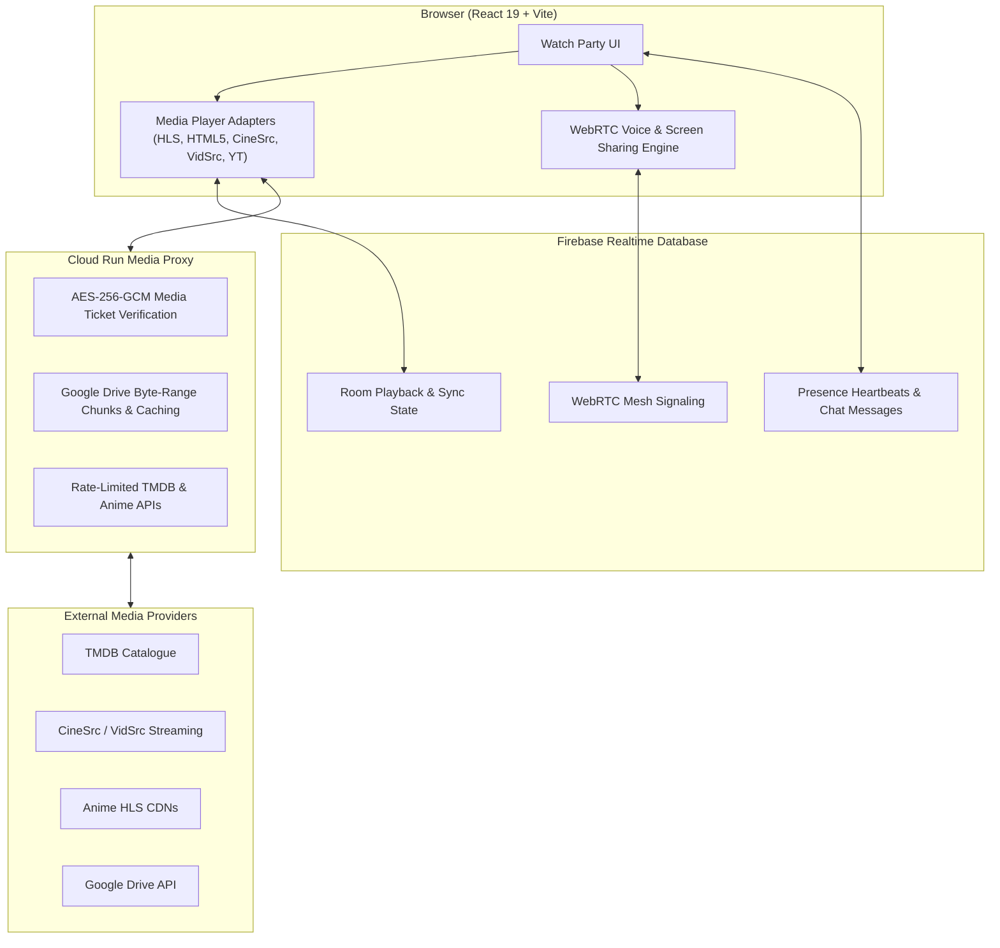

# 🍿 Watch Party

> A modern, synchronized social streaming platform for watching movies, TV shows, anime, YouTube, and Google Drive videos together with friends across the globe in real time.

[](https://partyapp-fun.netlify.app/)
[](https://react.dev/)
[](https://vitejs.dev/)
[](https://tailwindcss.com/)
[](https://firebase.google.com/)
[](https://vitest.dev/)

---

## 🌟 Highlights

- 🌐 **Watch Together in Real Time**: Create a room, share the invite link, and stream videos in lockstep synchronization.
- 🎬 **Movies & TV Shows**: Full TMDB catalogue with search, genre & language filters, season/episode explorers, and dual stream providers (CineSrc & VidSrc) with mobile-responsive controls.
- 🎌 **Anime & Manga**: Fast HLS streaming with multi-audio (Sub & Dub tracks), alternative server selection, and an integrated Manga reader with smooth page prefetching.
- 📁 **Google Drive Range Proxy**: High-performance streaming of personal Google Drive videos with sub-second rapid seeking and AES-256-GCM ticket verification.
- 🎙️ **WebRTC Mesh Voice Chat**: Talk with room members in real time featuring active audio activity rings, mute memory, and a persistent mobile voice dock.
- 🖥️ **Screen Sharing**: Low-latency peer-to-peer screen broadcasting directly on the room's main video stage.
- 💬 **Interactive Chat & Reactions**: Live chat with typing indicators, audio voice notes, and floating emoji reaction bursts.
- 🛡️ **Host Moderation**: Granular room management with member kick and ban capabilities.
- 📚 **Personal Library**: Track Watch History, Continue Watching progress, and Wishlists across all content types with 1-click removal.

---

## 🏗️ Architecture



---

## 🚀 Key Features

### 1. Multi-Source Synchronized Media Player
- **Host Playback Authority**: The host controls play, pause, seek, and episode selection; participant browsers synchronize playback with intelligent drift detection.
- **Provider Fallback**: Seamless 1-click toggling between streaming mirrors (e.g. CineSrc ⇄ VidSrc) directly beneath the video stage.
- **Mobile Responsive & Touch-Optimized**: Custom-tailored touch controls, safe-zone spacing, and screen wake-lock permissions to prevent device sleep during playback.

### 2. Anime & Manga Suite
- **Anime Streaming**: Multi-source HLS video playback with instant toggling between Subtitled and Dubbed audio tracks.
- **Manga Reader**: High-speed reader featuring bounded memory caching, preloaded chapter pages, and automatic reading position tracking.

### 3. Voice Chat & Screen Sharing
- **Peer-to-Peer Voice Mesh**: Low-latency real-time voice chat with audio meters and permissions error recovery.
- **In-Room Screen Sharing**: Share desktop applications or browser tabs without external software.

### 4. Social & Library System
- **Reactions & Chat**: Instant message delivery with reply editing, animated emoji bursts, and audio recordings.
- **Unified Library**: Resume movies, TV episodes, anime, or personal uploads across devices with persistent bookmarks and 1-click delete buttons.

---

## 🛠️ Tech Stack

| Layer | Technologies |
| :--- | :--- |
| **Frontend Framework** | React 19, Vite 7 |
| **Styling** | Tailwind CSS 3, Lucide React Icons |
| **State & Sync** | Firebase Realtime Database 12 |
| **Video & Streaming** | HLS.js 1.7, HTML5 Video API, YouTube IFrame API |
| **Real-Time Audio / Video** | WebRTC (Mesh topology) |
| **Testing** | Vitest 4, Playwright 1.64, Testing Library |
| **Deployment** | Netlify CDN (`https://partyapp-fun.netlify.app/`) |

---

## 💻 Getting Started

### Prerequisites
- **Node.js**: v22.0.0 or higher
- **npm**: v10.0.0 or higher
- A **Firebase** project with Realtime Database and Authentication enabled

### Installation

1. Clone the repository:
   ```bash
   git clone https://github.com/iamcute936968-creator/Party_app_for_friends.git
   cd Party_app_for_friends
   ```

2. Install dependencies:
   ```bash
   npm install
   ```

3. Configure environment variables:
   Copy `.env.example` to `.env`:
   ```bash
   cp .env.example .env
   ```

   Fill in your configuration:
   ```env
   VITE_GOOGLE_CLIENT_ID=your-google-oauth-client-id
   VITE_MEDIA_PROXY_URL=http://localhost:3000
   VITE_DRIVE_STREAMING=true
   ```

4. Start the local development server:
   ```bash
   npm run dev
   ```

   Open your browser at `http://localhost:5175`.

---

## 🧪 Testing & Verification

The project follows strict **Test-Driven Development (TDD)** and automated regression checks:

```bash
# Run all unit and integration tests
npm test

# Run unit tests only
npm run test:unit

# Run integration tests only
npm run test:integration

# Run code linter
npm run lint

# Build for production
npm run build
```

Current test status: **105 test files passed (719 of 719 tests passing)**.

---

## 🔒 Security Hardening

- **Iframe Sandboxing**: Embedded movie and anime iframes are confined with `sandbox="allow-scripts allow-same-origin"`. Risky permissions such as `allow-presentation`, `allow-top-navigation`, and `allow-modals` are strictly omitted to block ad popups and extension probing.
- **Hardware Permissions**: Delegated iframe permissions are restricted via `allow="autoplay; fullscreen; picture-in-picture; screen-wake-lock"`. Sensitive hardware APIs (microphone, camera, geolocation, payments) are blocked.
- **Data Isolation**: Cross-origin third-party players cannot access local storage, session data, or Firebase credentials.

---

## 📜 Attributions & Acknowledgments

- **The Movie Database (TMDB)**: This product uses the TMDB API but is not endorsed or certified by TMDB.
- **Lucide Icons**: Beautiful open-source icons for modern web interfaces.
- **HLS.js**: Robust HTTP Live Streaming client library.

---

## 📄 License

This project is open-source and available under the [ISC License](LICENSE).
